<div align="center">

# 🖼️ Desk Dashboard

**A $50 Amazon photo frame, rooted and turned into a voice-controlled desk command center.**

PSG · India cricket · Fantasy PL · groceries with calories · water & supplements · Alexa · smart home · chess · focus timer


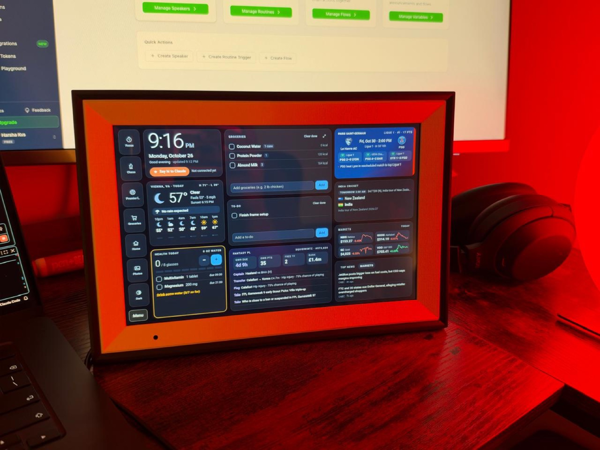

<sub>On my desk. <a href="docs/media/desk-tour.mp4">Watch the 48-second video</a> (dark and light mode).</sub>

<br><br>

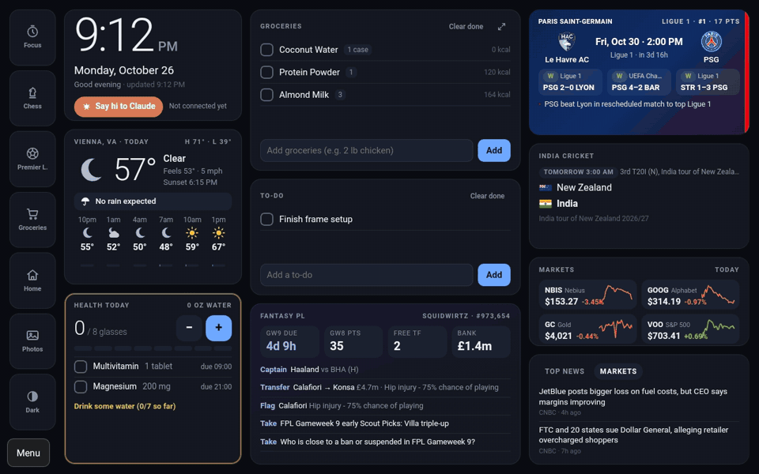

<sub>Every frame above is a real screenshot pulled off the device over ADB.</sub>

</div>

---

## The short version

[Wes Bos showed](https://wesbos.com/hacking-smart-photo-frames) that cheap Android photo frames are really
tablets in disguise. I bought one (a **PF1007L**: Allwinner A33, 1 GB RAM, Android 6.0.1), followed his
[photo-frame-dashboard](https://github.com/wesbos/photo-frame-dashboard) repo to get root, and then kept going:

- **Rooted it without flashing anything** by redirecting the vendor app's command server to my laptop and
  sending it one command.
- **Took a full, checksum-verified 15.7 GB backup** before changing a single byte.
- **Swapped the 2015 WebView 44 for WebView 106**, added the missing root certificates and installed the boot
  fixes so it survives power cuts.
- **Built this dashboard** on a Cloudflare Worker, so the frame needs nothing but Wi-Fi.
- **Wired up Alexa both ways**: "Alexa, tell my desk I drank water" updates the screen, and the screen's buttons
  run Alexa routines that control my lights.

The full story is on [my blog](https://harshakvs.github.io/my-portfolio/blog/desk-frame).

## What's on it

<table>
<tr>
<td width="50%">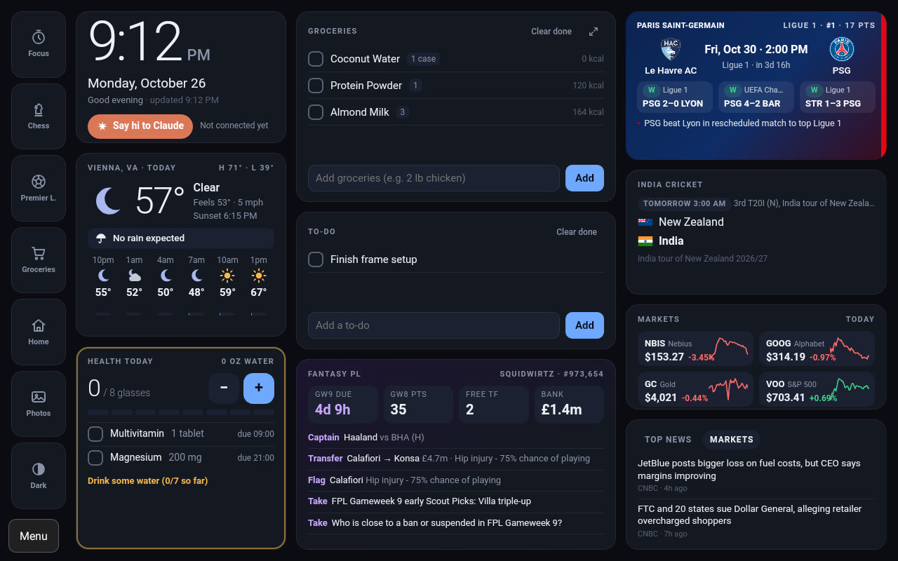</td>
<td>

**Always on screen**

- 🕘 Clock, greeting and birthday reminders
- 🎂 Birthdays synced from Apple Contacts (the source of Apple Calendar's Birthdays calendar)
- ✳️ **Say hi to Claude**: starts my Claude usage window early (GitHub Action runs `claude -p`)
- 🌤️ Today's weather, rain timing and the next 18 hours
- 💧 Water and supplement tracker with reminders
- 🛒 Groceries (with quantities and calories) and to-do
- ⚽ Fantasy PL: deadline, points, free transfers, bank, captain and transfer ideas, Scout articles
- 🔴🔵 PSG: next match countdown, last results, Ligue 1 position
- 🏏 India cricket: live batters, bowler and every ball of the over
- 📈 Watchlist with sparklines, plus news you can tap to read

</td>
</tr>
</table>

<table>
<tr>
<td>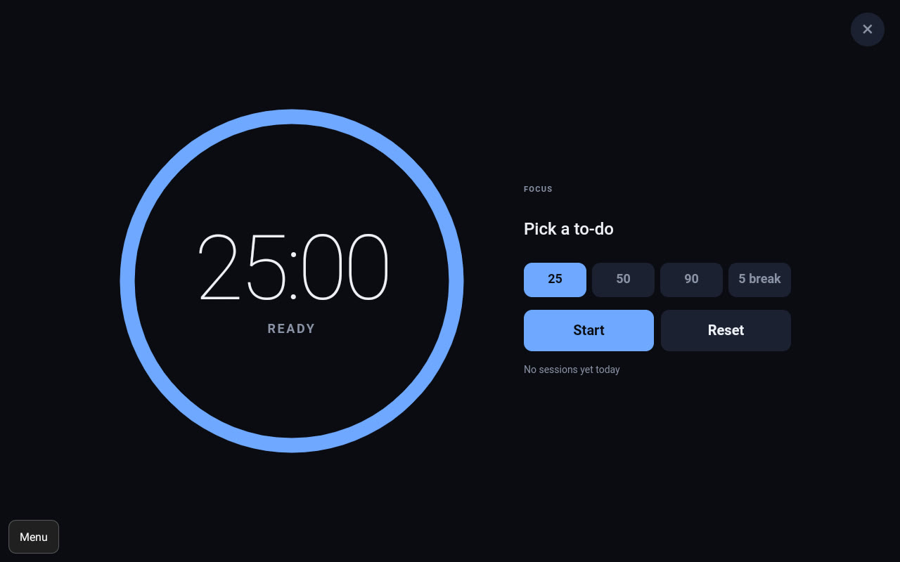<p align="center"><b>Focus timer</b><br><sub>25/50/90 min, linked to a to-do</sub></p></td>
<td>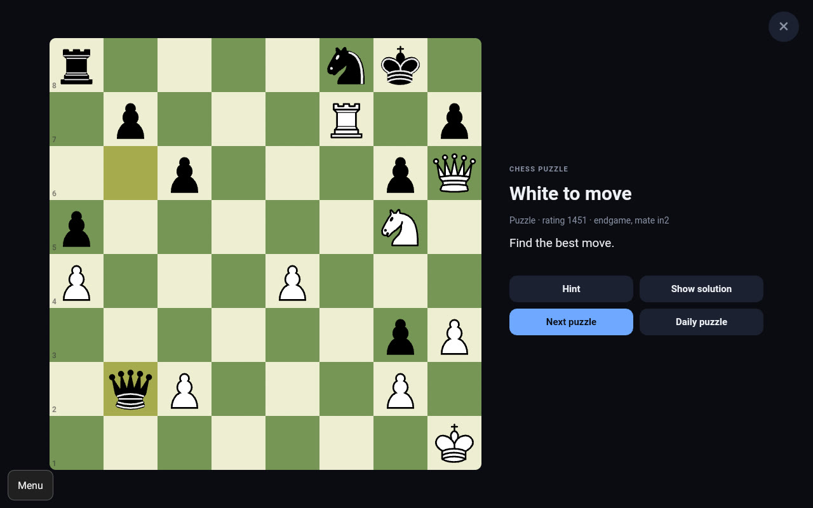<p align="center"><b>Chess puzzles</b><br><sub>Lichess daily + random, tap to move</sub></p></td>
<td>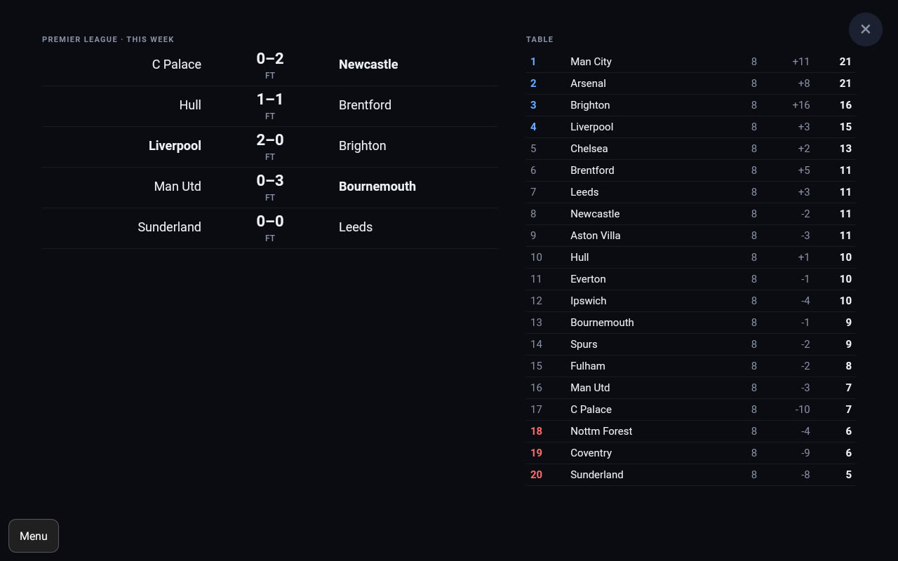<p align="center"><b>Premier League</b><br><sub>This week's scores and the table</sub></p></td>
</tr>
<tr>
<td>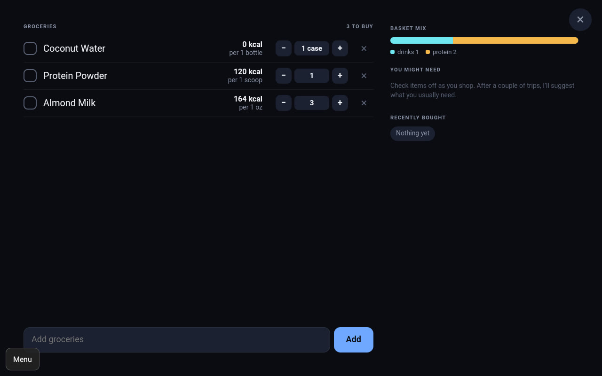<p align="center"><b>Groceries</b><br><sub>Calories, basket mix, "you might need"</sub></p></td>
<td>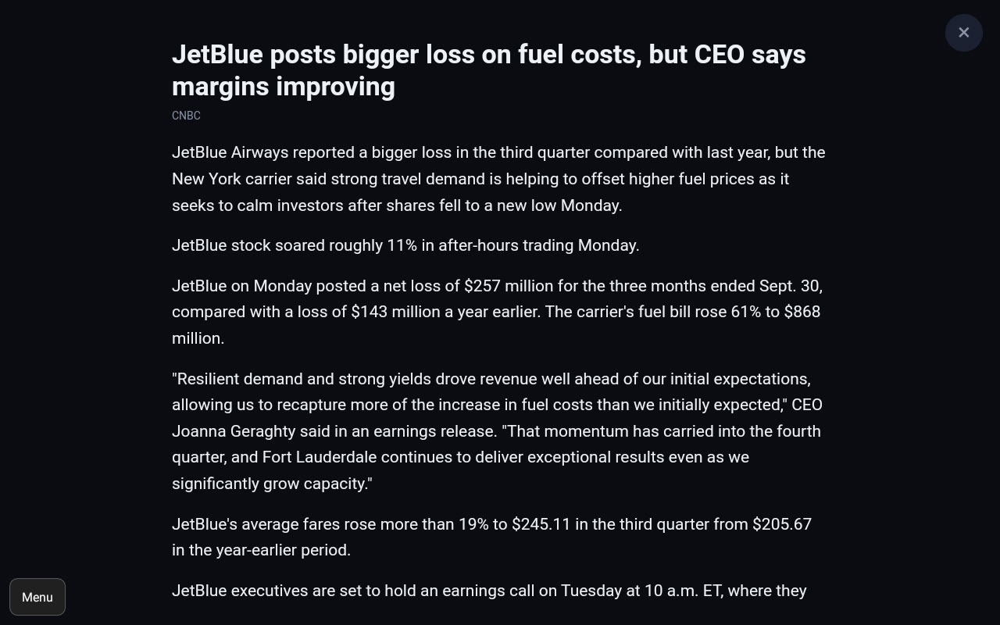<p align="center"><b>Article reader</b><br><sub>Ad-free text view of news and FPL takes</sub></p></td>
<td>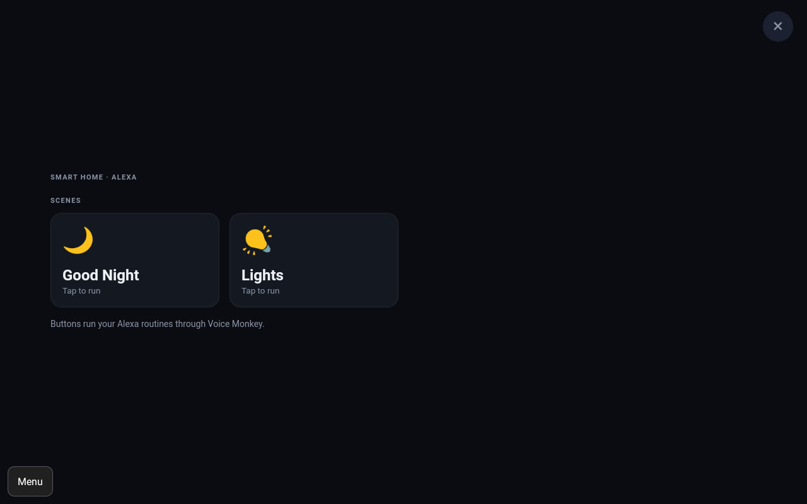<p align="center"><b>Smart home</b><br><sub>Alexa routines via Voice Monkey</sub></p></td>
</tr>
</table>

<p align="center">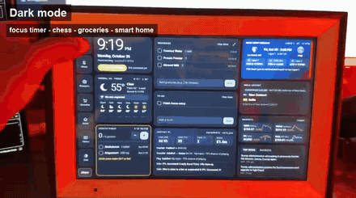</p>

Plus a photo screensaver after 5 idle minutes (a dim clock overnight), and light/dark themes that follow sunrise and sunset.

## Talk to it

```text
"Alexa, ask my desk for my FPL score"           → points, rank, free transfers, deadline, captain
"Alexa, tell my desk I drank water"             → water counter goes up on the frame
"Alexa, tell my desk I took my magnesium"       → supplement ticked off
"Alexa, ask my desk when do PSG play"
"Alexa, ask my desk for the India score"
```

🔊 [Watch Alexa answer the FPL question](docs/media/fpl-alexa-web.mp4) (sound on).

**Groceries by voice are a known limitation.** Alexa's built-in shopping list intercepts anything that sounds like
"add X", even inside the skill's own session, and Amazon closed third-party access to that list in July 2024. The
skill still has a grocery intent (custom slot, slot elicitation, splitting "eggs and bread"), but in practice
groceries go in on the frame. Home Assistant's Alexa integration, which can read Alexa's list, is the planned fix.

## How it works

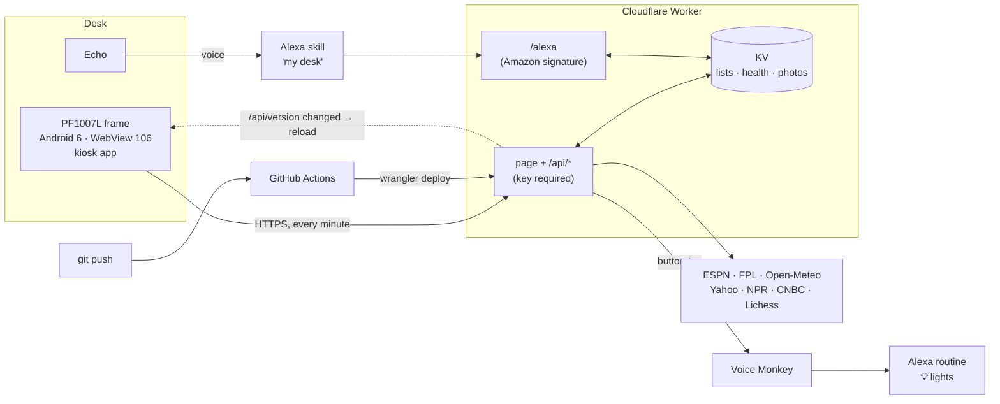

- **The frame is just a screen.** It runs [Wes's kiosk app](https://github.com/wesbos/photo-frame-dashboard/tree/main/dashboard/kiosk)
  pointed at the Worker. Every data source is fetched and trimmed server-side, so the 1 GB device only renders
  small JSON and stays around 60–80 MB of RAM.
- **Plain HTML, CSS and JS, no build step.** It targets WebView 106, so no `oklch()`, `color-mix()`, `:has()` or
  CSS nesting. A fixed 1280×800 stage is scaled to the screen.
- **One source of truth.** The frame, Alexa and the grocery suggestions all read and write the same KV
  records, so a spoken "add milk" shows up on screen within 30 seconds.
- **Push to deploy.** GitHub Actions deploys on every push, and the page polls `/api/version` and reloads
  itself within a minute.

## Run your own

You'll need a frame you've already unlocked (start at
[wesbos/photo-frame-dashboard](https://github.com/wesbos/photo-frame-dashboard)) and a free Cloudflare account.

```sh
git clone https://github.com/harshakvs/desk-dashboard && cd desk-dashboard
npm install
npm run dev                                   # http://localhost:8787
```

1. Make it yours: location and watchlist in `src/worker.js`, FPL team ID in `wrangler.jsonc`, supplements in
   `src/health.js`, extra birthdays in `src/birthdays.js`.
2. Create a KV namespace (`npx wrangler kv namespace create LISTS`), put its ID and your `account_id` in
   `wrangler.jsonc`, then `npm run deploy`.
3. Lock it: `openssl rand -hex 16 | npx wrangler secret put DASH_TOKEN` (save that value), then point the kiosk at
   `https://<your-worker>.workers.dev/?k=<that value>`.
4. Optional extras:

| Feature | Setup |
| --- | --- |
| Auto-deploy | Repo secret `CLOUDFLARE_API_TOKEN` ("Edit Cloudflare Workers" template) |
| Alexa | `ask smapi create-skill-for-vendor --manifest file:alexa/skill.json`, upload `alexa/en-US.json`, then `wrangler secret put ALEXA_SKILL_ID` |
| Smart home | Voice Monkey Routine Triggers (`Lights`, `Good Night`, or `Room Lights On`/`Off`), then `wrangler secret put VOICEMONKEY_TOKEN` |
| Claude button | Repo secret `CLAUDE_CODE_OAUTH_TOKEN` (`claude setup-token`); Worker secrets `GH_REPO` and a fine-grained `GH_TOKEN` (Actions: write) |
| Photos | Drop them in `photos-src/`, run `npm run photos` (uploaded to KV, never committed) |
| Birthdays | `npm run birthdays` copies them from Apple Contacts into KV |

## Security notes

- Everything under `/api/*` and `/photos/*` needs the dashboard key. The page shell is public but contains no data.
- `/alexa` only accepts requests signed by Amazon for this skill ID, within 150 seconds.
- The image proxy only fetches from an allowlist (ESPN, Lichess).
- Photos, contact birthdays and every token live in Cloudflare (KV or secrets), never in git.
- The frame has no open network ports. Root ADB is only reachable over its USB cable.

## Credits

- [Wes Bos](https://github.com/wesbos) and everyone in [photo-frame-dashboard](https://github.com/wesbos/photo-frame-dashboard)
  for the unlock research, boot fixes and kiosk app. None of this works without it.
- Data: [ESPN](https://www.espn.com), [Fantasy Premier League](https://fantasy.premierleague.com),
  [Open-Meteo](https://open-meteo.com), [Lichess](https://lichess.org), Yahoo Finance, NPR, CNBC,
  [Fantasy Football Scout](https://www.fantasyfootballscout.co.uk).
- [chess.js](https://github.com/jhlywa/chess.js) (BSD-2) for move validation, piece art by Lichess (cburnett).
- Built with [Claude Code](https://claude.com/claude-code).
